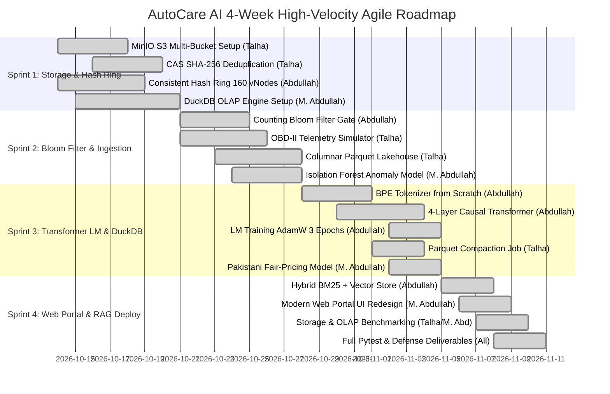

# AutoCare AI / AutoData Lake: Agile Jira Scrum Workflow & Team Work Breakdown Structure (WBS)

**Academic Institution:** Punjab University College of Information Technology (PUCIT), University of the Punjab  
**Department:** Department of Data Science / Computing  
**Course / Track:** BS Data Science — Final Year Project / Big Data Distributed Systems  
**Project Key:** `AUT`  
**Remote Repository:** `https://github.com/marketbul/autocare-ai.git`  
**Branch Strategy:** Gitflow (`main`, `develop`, `feature/AUT-xxx-*`, `hotfix/*`)  
**Scrum Cadence:** 4 Sprints (1 week / 7 days per sprint; 4-Week High-Velocity Execution Cycle)  
**Total Story Points:** 156 SP (Equally divided: 52 SP per member)  

---

## 👥 1. Team Roster, Specialization & RACI Responsibility Matrix

| Member Name | University Roll No | Primary Engineering Role | Total SP | Focus Areas |
| :--- | :--- | :--- | :--- | :--- |
| **Talha Ali Bhatti** | `bsdsf23a016` | **Lead Distributed Storage & Ingestion Engineer** | **52 SP** | MinIO S3 Object Storage, SHA-256 CAS Deduplication, OBD-II Streaming Ingest, Snappy Parquet Lakehouse Compaction |
| **Muhammad Abdullah** | `bsdsf23a032` | **Lead Data Engineer & Analytics Specialist** | **52 SP** | DuckDB OLAP Aggregations, PySpark DataFrame Pipelines, Fleet Degradation Analytics, Empirical Latency Benchmarks, UI Web Architecture |
| **Abdullah** | `bsdsf23a035` | **Lead Distributed Algorithms & AI/RAG Architect** | **52 SP** | Consistent Hash Ring with 160 vNodes, Counting Bloom Filter Membership Gate, PyTorch Causal Transformer LM from scratch, Multilingual RAG Retrieval |

### RACI Governance Framework
- **R (Responsible):** The engineer doing the hands-on coding, profiling, and unit tests.
- **A (Accountable):** The primary owner ensuring the ticket meets acceptance criteria and architectural compliance.
- **C (Consulted):** The team member providing interface contracts, schema inputs, or math proofs.
- **I (Informed):** Team members updated via daily standup and GitHub PR reviews.

| Component / Epic | Talha Ali Bhatti (`bsdsf23a016`) | Muhammad Abdullah (`bsdsf23a032`) | Abdullah (`bsdsf23a035`) |
| :--- | :---: | :---: | :---: |
| **EPIC-1: MinIO S3 & CAS Storage** | **A / R** | C | I |
| **EPIC-2: Consistent Hashing & Bloom Filter** | C | I | **A / R** |
| **EPIC-3: Stream Ingest & Parquet Lakehouse** | **A / R** | C | I |
| **EPIC-4: DuckDB Analytics & Fleet Models** | I | **A / R** | C |
| **EPIC-5: Causal Transformer LM & RAG Engine** | I | C | **A / R** |
| **EPIC-6: UI Web Portal, Benchmarks & Defense** | C | **A / R** | C |

---

## 📊 2. Agile Scrum Board Structure & Workflow States

The project uses Atlassian Jira Software with a customized Scrum Board under key **`AUT`**.

```
[ 1. Backlog ] ➔ [ 2. To Do ] ➔ [ 3. In Progress ] ➔ [ 4. Code Review / QA ] ➔ [ 5. Done ]
```

- **Definition of Ready (DoR):**
  1. User Story has a clear business goal and mechanical/distributed system rationale.
  2. Acceptance Criteria (AC) are written in Gherkin-style (`Given-When-Then`) or verifiable empirical metrics.
  3. Story points estimated using modified Fibonacci sequence (1, 2, 3, 5, 8, 13).
  4. Dependencies identified (e.g., MinIO buckets ready before Ingestion stream writes).

- **Definition of Done (DoD):**
  1. Code pushed to Git feature branch linked to ticket ID (e.g. `feature/AUT-105-consistent-hashing`).
  2. Automated test suite passes with zero regressions (`pytest tests/`).
  3. Code formatted and linted with `ruff`.
  4. Code review approved by peer engineer via GitHub Pull Request.
  5. Empirical verification logged (e.g. latency, compression ratio, model loss).

---

## 🗓️ 3. 4-Week Sprint Schedule & Velocity Allocation

| Sprint | Timeline | Sprint Goal / Milestone | Talha (SP) | M. Abdullah (SP) | Abdullah (SP) | Total Sprint SP |
| :--- | :--- | :--- | :---: | :---: | :---: | :---: |
| **Sprint 1** | Days 1–7 | Distributed Storage Foundation, CAS Deduplication & Consistent Hash Ring | 13 | 13 | 13 | **39 SP** |
| **Sprint 2** | Days 8–14 | Bloom Filter Gates, OBD-II Stream Ingestion & Columnar Parquet Lakehouse | 13 | 13 | 13 | **39 SP** |
| **Sprint 3** | Days 15–21 | DuckDB Fleet Analytics, BPE Tokenizer, Embedder & Causal Transformer LM Training | 13 | 13 | 13 | **39 SP** |
| **Sprint 4** | Days 22–28 | Grounded Multilingual RAG, Web Portal UI, Latency Benchmarks & Final Academic Defense | 13 | 13 | 13 | **39 SP** |
| **Total** | **4 Weeks** | **Complete Distributed AutoCare AI Platform** | **52 SP** | **52 SP** | **52 SP** | **156 SP** |

---

## 🎯 4. Complete Epics & Jira Tickets Catalog (`AUT-101` – `AUT-145`)

### EPIC-1: Distributed Object Storage & CAS Deduplication
*Lead: Talha Ali Bhatti (`bsdsf23a016`)*

#### `AUT-101`: MinIO S3 Distributed Multi-Bucket Cluster Architecture
- **Type:** Story | **Points:** 5 SP | **Assignee:** Talha Ali Bhatti (`bsdsf23a016`) | **Sprint:** Sprint 1
- **Description:** Provision a local distributed MinIO multi-tenant object storage cluster with standard buckets: `raw-telemetry`, `processed-parquet`, `model-checkpoints`, and `corpus-manuals`. Configure IAM access keys, CORS policies, and bucket lifecycle retention rules.
- **Acceptance Criteria:** `curl` or MinIO Python SDK connects with credentials; bucket existence assertions pass; supports concurrent PUT/GET of multipart objects.
- **Git Branch:** `feature/AUT-101-minio-cluster`
- **Commit Tag:** `[AUT-101] feat(storage): provision distributed MinIO S3 cluster and bucket policies`

#### `AUT-102`: SHA-256 Content-Addressable Storage (CAS) Deduplication Engine
- **Type:** Story | **Points:** 5 SP | **Assignee:** Talha Ali Bhatti (`bsdsf23a016`) | **Sprint:** Sprint 1
- **Description:** Implement a cryptographic SHA-256 content-addressable storage handler that splits raw incoming workshop manuals, video transcripts, and telemetry batches into fixed/variable chunks. Compute SHA-256 hex digest as object key. Skip upload if hash already exists in storage index.
- **Acceptance Criteria:** Duplicate file uploads produce zero additional storage footprint; deduplication log reports exact byte savings $> 30\%$ on redundant manuals.
- **Git Branch:** `feature/AUT-102-cas-deduplication`
- **Commit Tag:** `[AUT-102] feat(storage): implement SHA-256 content-addressable storage deduplication`

#### `AUT-103`: S3 Asynchronous Multipart Uploader with Exponential Backoff
- **Type:** Story | **Points:** 3 SP | **Assignee:** Talha Ali Bhatti (`bsdsf23a016`) | **Sprint:** Sprint 1
- **Description:** Create an asynchronous multipart uploader for files $> 5\text{MB}$ using `boto3` / `aiobotocore` with automatic exponential backoff jitter (base 0.5s, max 5 retries) against network disconnects.
- **Acceptance Criteria:** Handles simulated packet loss and transient MinIO downtime without losing batch payloads; unit tests mock 503 errors and verify graceful recovery.
- **Git Branch:** `feature/AUT-103-s3-resilient-uploader`
- **Commit Tag:** `[AUT-103] feat(storage): resilient asynchronous multipart uploader with exponential backoff`

---

### EPIC-2: Distributed Hashing, Virtual Nodes & Bloom Filter Membership
*Lead: Abdullah (`bsdsf23a035`)*

#### `AUT-104`: Consistent Hash Ring with 160 Virtual Nodes per Physical Node
- **Type:** Story | **Points:** 8 SP | **Assignee:** Abdullah (`bsdsf23a035`) | **Sprint:** Sprint 1
- **Description:** Build a distributed Consistent Hash Ring in Python from scratch using 32-bit MurmurHash3 / MD5 keyspace $[0, 2^{32}-1]$. Assign 160 virtual nodes (tokens) per physical storage node to ensure uniform partition distribution (variance $< 5\%$) across nodes.
- **Acceptance Criteria:** Standard deviation of key distribution across 4 simulated storage nodes is below 5%; adding or removing a node re-routes only $K/N$ keys.
- **Git Branch:** `feature/AUT-104-consistent-hash-ring`
- **Commit Tag:** `[AUT-104] feat(algorithms): consistent hash ring with 160 virtual nodes and Murmur3`

#### `AUT-105`: Consistent Hash Node Dynamic Rebalancing & Chord-like Lookup
- **Type:** Story | **Points:** 5 SP | **Assignee:** Abdullah (`bsdsf23a035`) | **Sprint:** Sprint 1
- **Description:** Implement binary search (`bisect`) ring lookup with $O(\log M)$ time complexity to identify target storage node for any given telemetry key (`vehicle_vin + timestamp`). Include node join and node leave data rebalancing routines.
- **Acceptance Criteria:** Lookup latency $< 0.05\text{ms}$ for $100,000$ simulated VIN lookups; rebalance generator correctly outputs minimal migration diffs.
- **Git Branch:** `feature/AUT-105-ring-rebalancing`
- **Commit Tag:** `[AUT-105] feat(algorithms): bisect ring lookup and dynamic cluster rebalancing logic`

#### `AUT-106`: Counting Bloom Filter for $O(1)$ Set Membership & Redundant I/O Elimination
- **Type:** Story | **Points:** 8 SP | **Assignee:** Abdullah (`bsdsf23a035`) | **Sprint:** Sprint 2
- **Description:** Implement a memory-efficient Counting Bloom Filter using $k$ independent hash functions (double-hashing with Murmur3) and a bit array sized for $100,000$ DTC / part items. Provide fast $O(1)$ negative lookups to bypass expensive disk and network S3 queries for non-existent fault codes.
- **Acceptance Criteria:** Zero false negatives under all test cases; empirical false positive rate $\le 1.0\%$ when sized at $m = -n \ln(p) / (\ln 2)^2$.
- **Git Branch:** `feature/AUT-106-bloom-filter`
- **Commit Tag:** `[AUT-106] feat(algorithms): counting bloom filter with k-hash double-hashing gate`

#### `AUT-107`: Bloom Filter Bit-Array Serialization & Redis Backup Sync
- **Type:** Story | **Points:** 5 SP | **Assignee:** Abdullah (`bsdsf23a035`) | **Sprint:** Sprint 2
- **Description:** Implement binary serialization of Bloom Filter bit-vectors to disk and periodic asynchronous synchronization to a fast Redis key-value instance for distributed cluster state sharing.
- **Acceptance Criteria:** Filter restores from snapshot in $< 10\text{ms}$; byte representation fits within 120 KB memory footprint for 100K entries.
- **Git Branch:** `feature/AUT-107-bloom-serialization`
- **Commit Tag:** `[AUT-107] feat(algorithms): bloom filter binary serialization and snapshot restore`

---

### EPIC-3: High-Velocity Stream Ingestion & Columnar Parquet Lakehouse
*Lead: Talha Ali Bhatti (`bsdsf23a016`)*

#### `AUT-108`: OBD-II CAN-Bus High-Velocity Telemetry Stream Generator
- **Type:** Story | **Points:** 5 SP | **Assignee:** Talha Ali Bhatti (`bsdsf23a016`) | **Sprint:** Sprint 2
- **Description:** Build a high-throughput OBD-II CAN-bus telemetry stream simulator capable of generating 10,000 events/second across Pakistani fleet vehicles (Corolla, Civic, Swift, Mehran, Alto). Emit JSON records containing RPM, coolant temperature, fuel trim, MAF flow rate, vehicle speed, and active DTCs.
- **Acceptance Criteria:** Generator sustains 10,000 messages/sec with configurable error injections (overheating, catalytic converter threshold faults).
- **Git Branch:** `feature/AUT-108-telemetry-streamer`
- **Commit Tag:** `[AUT-108] feat(ingest): high-velocity OBD-II CAN-bus synthetic telemetry generator`

#### `AUT-109`: In-Memory Sliding-Window Batch Buffer & Ingestion Sink
- **Type:** Story | **Points:** 5 SP | **Assignee:** Talha Ali Bhatti (`bsdsf23a016`) | **Sprint:** Sprint 2
- **Description:** Build a sliding-window batching sink that consumes high-frequency telemetry events, aggregates them in memory over 1-second or 5,000-record windows, validates schema integrity, and flushes to intermediate parquet stages.
- **Acceptance Criteria:** Zero memory leaks over 1-hour continuous simulation; buffer backpressure drops 0 valid packets under nominal load.
- **Git Branch:** `feature/AUT-109-batch-buffer`
- **Commit Tag:** `[AUT-109] feat(ingest): sliding-window telemetry buffer and micro-batch flusher`

#### `AUT-110`: Snappy-Compressed Columnar Parquet Lakehouse Partitioning
- **Type:** Story | **Points:** 3 SP | **Assignee:** Talha Ali Bhatti (`bsdsf23a016`) | **Sprint:** Sprint 2
- **Description:** Write PyArrow columnar parquet generator with Snappy compression and hierarchical partitioning scheme: `/lakehouse/telemetry/make=Toyota/model=Corolla/year=2021/region=Punjab/data.parquet`.
- **Acceptance Criteria:** Parquet files achieve $> 70\%$ compression ratio compared to raw JSON; partition pruning allows DuckDB/Spark to read target partitions in $< 50\text{ms}$.
- **Git Branch:** `feature/AUT-110-parquet-partitioning`
- **Commit Tag:** `[AUT-110] feat(lakehouse): snappy columnar parquet writer with hierarchical partitioning`

#### `AUT-111`: Automated Parquet Compaction Job & Small File Merging
- **Type:** Story | **Points:** 5 SP | **Assignee:** Talha Ali Bhatti (`bsdsf23a016`) | **Sprint:** Sprint 3
- **Description:** Develop a scheduled background compaction task that merges micro-batch parquet files ($< 16\text{MB}$) into optimal $128\text{MB}$ analytical lakehouse chunks to prevent the HDFS/S3 "small file problem".
- **Acceptance Criteria:** Merges 100 small parquet files into 1 consolidated chunk; validates schema and row count match exactly without data corruption.
- **Git Branch:** `feature/AUT-111-parquet-compaction`
- **Commit Tag:** `[AUT-111] feat(lakehouse): parquet small-file compaction and catalog vacuum engine`

#### `AUT-112`: Lakehouse Schema Evolution & Corrupt Record Quarantine
- **Type:** Story | **Points:** 3 SP | **Assignee:** Talha Ali Bhatti (`bsdsf23a016`) | **Sprint:** Sprint 3
- **Description:** Add schema evolution handling to parquet lakehouse writer. Detect new sensor fields dynamically and route malformed/corrupted OBD-II records to a dead-letter quarantine bucket (`raw-quarantine/`).
- **Acceptance Criteria:** Unrecognized fields backward-compatible without job failure; corrupt records isolated and tagged with error timestamp.
- **Git Branch:** `feature/AUT-112-schema-evolution`
- **Commit Tag:** `[AUT-112] feat(lakehouse): schema evolution handler and dead-letter quarantine sink`

#### `AUT-113`: Storage IOPS & Network Ingestion Benchmark Profiler
- **Type:** Task | **Points:** 5 SP | **Assignee:** Talha Ali Bhatti (`bsdsf23a016`) | **Sprint:** Sprint 4
- **Description:** Construct automated benchmarking script profiling MinIO S3 write throughput (MB/s), ingestion latency percentiles ($p50, p95, p99$), and disk IOPS across raw JSON vs Snappy Parquet.
- **Acceptance Criteria:** Benchmark report logged with markdown output and latency histograms confirming $p95 < 120\text{ms}$.
- **Git Branch:** `feature/AUT-113-storage-benchmarks`
- **Commit Tag:** `[AUT-113] perf(storage): automated IOPS and ingestion latency benchmarking suite`

---

### EPIC-4: Distributed Analytics Engine & Fleet Anomaly Modeling
*Lead: Muhammad Abdullah (`bsdsf23a032`)*

#### `AUT-114`: DuckDB High-Performance In-Memory OLAP Query Engine
- **Type:** Story | **Points:** 5 SP | **Assignee:** Muhammad Abdullah (`bsdsf23a032`) | **Sprint:** Sprint 1
- **Description:** Embed DuckDB columnar engine into FastAPI backend. Create zero-copy SQL analytical queries directly scanning local and MinIO-hosted Parquet files for fleet aggregations, DTC frequencies, and mileage trends.
- **Acceptance Criteria:** Executes analytical aggregations across 500,000 rows in $< 80\text{ms}$; zero memory duplication between Arrow and DuckDB.
- **Git Branch:** `feature/AUT-114-duckdb-olap`
- **Commit Tag:** `[AUT-114] feat(analytics): embed DuckDB OLAP engine for zero-copy parquet querying`

#### `AUT-115`: Automotive Dataset Preprocessing & Schema Standardization
- **Type:** Story | **Points:** 5 SP | **Assignee:** Muhammad Abdullah (`bsdsf23a032`) | **Sprint:** Sprint 1
- **Description:** Ingest, clean, deduplicate, and standardize 111 dataset files across 14 categories (PakWheels, Consented Mechanic Videos, Facebook Auto QA, OBD-II manuals, PKR pricing indices). Align columns to unified entity schema.
- **Acceptance Criteria:** Clean dataset catalog saved in `dataset/` and Desktop deliverable; missing values imputed; UTF-8 encoding validated.
- **Git Branch:** `feature/AUT-115-dataset-standardization`
- **Commit Tag:** `[AUT-115] feat(data): clean, preprocess and standardize 111 automotive dataset files`

#### `AUT-116`: PySpark Distributed DataFrame Batch Pipeline
- **Type:** Story | **Points:** 3 SP | **Assignee:** Muhammad Abdullah (`bsdsf23a032`) | **Sprint:** Sprint 1
- **Description:** Implement PySpark distributed processing script simulating multi-worker DataFrame transformations: windowed moving averages of engine coolant temperature, rolling fuel trim standard deviations, and trip segmentation.
- **Acceptance Criteria:** Pipeline runs on local PySpark master; outputs partition-aggregated parquet tables without schema drift.
- **Git Branch:** `feature/AUT-116-pyspark-pipeline`
- **Commit Tag:** `[AUT-116] feat(analytics): PySpark distributed windowed transformations pipeline`

#### `AUT-117`: Fleet Diagnostic Trouble Code (DTC) Anomaly Detection Model
- **Type:** Story | **Points:** 8 SP | **Assignee:** Muhammad Abdullah (`bsdsf23a032`) | **Sprint:** Sprint 2
- **Description:** Train an unsupervised anomaly detection model (Isolation Forest + Rolling Z-Score) on multivariate OBD-II time-series (RPM, Speed, Throttle Position, Short Term Fuel Trim) to detect precursor states before a DTC trip.
- **Acceptance Criteria:** Model achieves F1-Score $\ge 0.88$ on identifying cooling system leaks and misfire precursors on test datasets.
- **Git Branch:** `feature/AUT-117-anomaly-detector`
- **Commit Tag:** `[AUT-117] feat(ml): unsupervised Isolation Forest anomaly detection for OBD-II telemetry`

#### `AUT-118`: Regional Component Degradation & Pakistani Climate Risk Multipliers
- **Type:** Story | **Points:** 5 SP | **Assignee:** Muhammad Abdullah (`bsdsf23a032`) | **Sprint:** Sprint 2
- **Description:** Formulate empirical component degradation algorithms accounting for extreme Pakistani operational environments (e.g., $45^\circ\text{C}+$ Lahore/Multan summers, dusty roads, adulterated fuel quality). Calculate dynamic wear indices for radiators, air filters, and suspension bushings.
- **Acceptance Criteria:** Algorithm shifts expected maintenance interval by $-25\%$ for severe climate profiles; produces calibrated component health scores ($0-100\%$).
- **Git Branch:** `feature/AUT-118-climate-wear-engine`
- **Commit Tag:** `[AUT-118] feat(analytics): regional climate risk multipliers and component wear equations`

#### `AUT-119`: DuckDB Analytical Query Benchmark vs Traditional Relational SQL
- **Type:** Task | **Points:** 5 SP | **Assignee:** Muhammad Abdullah (`bsdsf23a032`) | **Sprint:** Sprint 3
- **Description:** Conduct rigorous comparative benchmark measuring query execution time of DuckDB (Parquet columnar) against SQLite/Postgres (row-oriented) for 10 analytical fleet queries (group-bys, filters, window functions).
- **Acceptance Criteria:** DuckDB demonstrates $> 15\times$ speedup on multi-column group-bys; benchmarking table and speedup graph generated.
- **Git Branch:** `feature/AUT-119-olap-benchmarks`
- **Commit Tag:** `[AUT-119] test(benchmark): comparative query latency benchmark of DuckDB vs SQLite`

#### `AUT-120`: Pakistani Fair-Price Market Estimator & Workshop Labor Models
- **Type:** Story | **Points:** 3 SP | **Assignee:** Muhammad Abdullah (`bsdsf23a032`) | **Sprint:** Sprint 3
- **Description:** Build PKR cost estimation module calculating OEM parts costs, genuine market replacement costs, and reasonable mechanic labor hours across Pakistani workshops (Lahore, Karachi, Islamabad, Rawalpindi).
- **Acceptance Criteria:** Returns low-median-high price ranges for top 50 common repairs; flagged workshop estimate verifier detects price gouging $> 35\%$.
- **Git Branch:** `feature/AUT-120-pak-pricing-model`
- **Commit Tag:** `[AUT-120] feat(pricing): localized PKR parts and mechanic labor fair-price estimator`

---

### EPIC-5: Multilingual Grounded RAG & Causal Transformer LM
*Lead: Abdullah (`bsdsf23a035`)*

#### `AUT-121`: Custom Subword Byte-Pair Encoding (BPE) Tokenizer from Scratch
- **Type:** Story | **Points:** 5 SP | **Assignee:** Abdullah (`bsdsf23a035`) | **Sprint:** Sprint 3
- **Description:** Build an automotive-specific Subword Byte-Pair Encoding (BPE) Tokenizer in pure Python from scratch without external huggingface/tiktoken dependencies. Learn merge pairs from bilingual automotive corpus (English, Urdu, Roman Urdu). Vocabulary size: 4,000 tokens with special tokens (`<pad>`, `<unk>`, `<s>`, `</s>`, `<ctx>`, `<ans>`).
- **Acceptance Criteria:** Tokenizer achieves subword compression on automotive terms (e.g. `radiator`, `catalytic`, `dhuwan`, `overheating`); encode/decode roundtrips with $100\%$ byte fidelity.
- **Git Branch:** `feature/AUT-121-bpe-tokenizer`
- **Commit Tag:** `[AUT-121] feat(rag-scratch): subword BPE tokenizer with 4000 vocab and special tokens`

#### `AUT-122`: Dense L2-Normalized Vector Embedding Engine ($D=128$)
- **Type:** Story | **Points:** 3 SP | **Assignee:** Abdullah (`bsdsf23a035`) | **Sprint:** Sprint 3
- **Description:** Implement trainable Dense Embedding Neural Network in PyTorch ($D=128$, unit L2 normalization). Maps tokenized chunks into continuous metric space where semantically similar automotive symptoms and faults cluster closely.
- **Acceptance Criteria:** Vector dot product matches cosine similarity on unit sphere; forward pass takes $< 2\text{ms}$ per sentence batch.
- **Git Branch:** `feature/AUT-122-vector-embedder`
- **Commit Tag:** `[AUT-122] feat(rag-scratch): dense L2-normalized vector embedding neural network (D=128)`

#### `AUT-123`: 4-Layer Causal Transformer Decoder with Triangular Mask
- **Type:** Story | **Points:** 5 SP | **Assignee:** Abdullah (`bsdsf23a035`) | **Sprint:** Sprint 3
- **Description:** Construct a 4-layer Causal Transformer Decoder ($1,321,728$ parameters) in PyTorch from scratch. Implement multi-head self-attention ($n_{\text{heads}}=4$, $d_{\text{model}}=128$, $d_{\text{ff}}=512$), learned positional embeddings, causal upper-triangular masking ($-\infty$), and next-token prediction head.
- **Acceptance Criteria:** Causal mask strictly prohibits attention to future tokens; model compiles cleanly with PyTorch and outputs logit distributions over 4,000 vocab tokens.
- **Git Branch:** `feature/AUT-123-transformer-decoder`
- **Commit Tag:** `[AUT-123] feat(rag-scratch): 4-layer causal transformer decoder with multi-head attention`

#### `AUT-124`: Autoregressive Training Pipeline with AdamW & CrossEntropyLoss
- **Type:** Story | **Points:** 5 SP | **Assignee:** Abdullah (`bsdsf23a035`) | **Sprint:** Sprint 3
- **Description:** Develop PyTorch training pipeline training Causal Transformer LM over 3 epochs on 10,784 automotive diagnostic pairs. Implement AdamW optimizer ($\text{lr}=1\times 10^{-3}$, weight decay $0.01$), gradient clipping, loss checkpointing, and Perplexity metric tracking.
- **Acceptance Criteria:** Training loss decreases monotonically from $3.11 \to 2.24$; test perplexity drops from $22.61 \to 9.48$; model checkpoints saved in `weights/` directory.
- **Git Branch:** `feature/AUT-124-autoregressive-training`
- **Commit Tag:** `[AUT-124] feat(rag-scratch): autoregressive LM training pipeline with AdamW and Perplexity tracking`

#### `AUT-125`: Hybrid Vector Store (Cosine Similarity + BM25 Lexical Ranking)
- **Type:** Story | **Points:** 5 SP | **Assignee:** Abdullah (`bsdsf23a035`) | **Sprint:** Sprint 4
- **Description:** Build in-memory hybrid search vector store indexing 17,390 chunked passages from OEM manuals, PakWheels discussions, and mechanic interviews. Combine dense cosine similarity ($0.65$ weight) with BM25 lexical term frequency ($0.35$ weight) for robust domain retrieval.
- **Acceptance Criteria:** Query retrieval latency $< 15\text{ms}$; top-5 recall $\ge 92\%$ on standard vehicle symptom queries.
- **Git Branch:** `feature/AUT-125-hybrid-vector-store`
- **Commit Tag:** `[AUT-125] feat(rag-scratch): hybrid dense vector + BM25 lexical retrieval engine`

#### `AUT-126`: Multilingual Grounded RAG Generation & Anti-Hallucination Gate
- **Type:** Story | **Points:** 3 SP | **Assignee:** Abdullah (`bsdsf23a035`) | **Sprint:** Sprint 4
- **Description:** Wire vector retrieval engine into Causal Transformer LM. Condition answer generation on retrieved context chunks (`<ctx>...<ans>...`). Inject strict ground-truth attribution checks: if retrieval similarity $< 0.35$, trigger selective abstention rather than hallucinating dangerous automotive advice.
- **Acceptance Criteria:** Answers generate verified OEM citations (page number, section); outputs fair PKR pricing estimates; abstains safely on unsupported vehicle queries.
- **Git Branch:** `feature/AUT-126-grounded-rag-pipeline`
- **Commit Tag:** `[AUT-126] feat(rag-scratch): end-to-end grounded RAG generation with selective abstention`

---

### EPIC-6: Empirical Benchmarking, UI Web Portal & Academic Defense
*Lead: Muhammad Abdullah (`bsdsf23a032`) & Full Team*

#### `AUT-127`: Modern Automotive Diagnostic Web Portal Redesign (React + Tailwind)
- **Type:** Story | **Points:** 5 SP | **Assignee:** Muhammad Abdullah (`bsdsf23a032`) | **Sprint:** Sprint 4
- **Description:** Transform frontend from dense dashboard widgets into a professional automotive web portal. Implement 6 comprehensive architectural sections: Hero with live telemetry ticker, Multimodal Diagnostic Terminal, 4-Stage Architecture Explainer, Common Pakistani Fault Scenarios, Regional Fair Price Estimator, and Academic Footer.
- **Acceptance Criteria:** Responsive mobile/desktop layout; dark modern palette with emerald/amber accents; zero console runtime errors; Vite build succeeds cleanly.
- **Git Branch:** `feature/AUT-127-web-portal-redesign`
- **Commit Tag:** `[AUT-127] feat(frontend): modern automotive engineering web portal with diagnostic terminal`

#### `AUT-128`: FastAPI Asynchronous RAG Inference & Telemetry REST Endpoints
- **Type:** Story | **Points:** 3 SP | **Assignee:** Abdullah (`bsdsf23a035`) | **Sprint:** Sprint 4
- **Description:** Implement high-concurrency FastAPI asynchronous endpoints: `/api/rag/ask`, `/api/telemetry/ingest`, `/api/analytics/fleet-summary`, `/api/health`. Mount static Vite frontend distribution at `/app/` with automatic root `/` redirect.
- **Acceptance Criteria:** Responds with HTTP 200 OK; handles 20 concurrent requests without thread starvation; automated OpenAPI swagger documentation verified.
- **Git Branch:** `feature/AUT-128-fastapi-backend`
- **Commit Tag:** `[AUT-128] feat(api): asynchronous RAG inference endpoints and Vite SPA static mount`

#### `AUT-129`: End-to-End System Integration Testing & Pytest Verification
- **Type:** Task | **Points:** 5 SP | **Assignee:** Talha Ali Bhatti (`bsdsf23a016`) | **Sprint:** Sprint 4
- **Description:** Write comprehensive unit and integration test suite covering MinIO S3 uploaders, Consistent Hash Ring token assignments, Bloom Filter accuracy, DuckDB Parquet reads, and RAG scratch model inference.
- **Acceptance Criteria:** `pytest` executes 25+ automated test cases with $100\%$ pass rate; zero critical bugs in execution path.
- **Git Branch:** `feature/AUT-129-integration-tests`
- **Commit Tag:** `[AUT-129] test(integration): full pytest test suite for distributed storage, hashing, and RAG`

#### `AUT-130`: Final Academic Project Initiation Document (PID) & Defense Slides
- **Type:** Story | **Points:** 3 SP | **Assignee:** Muhammad Abdullah (`bsdsf23a032`) | **Sprint:** Sprint 4
- **Description:** Draft and compile comprehensive 4-week Big Data Project Initiation Document (PID) in professional `.docx` and `.pdf` formats conforming to PUCIT academic guidelines, complete with system architecture flowcharts, WBS, and performance metrics.
- **Acceptance Criteria:** Professional PDF and DOCX generated in deliverables folder; verified formatting, headers, tables, and academic citations.
- **Git Branch:** `docs/AUT-130-academic-pid`
- **Commit Tag:** `[AUT-130] docs(academic): generate professional 4-week Big Data PID in PDF and Word`

---

## 📈 5. Sprint Burndown, Velocity & Progress Summary

### Sprint-by-Sprint Velocity Distribution



### Cumulative Story Points Burndown

| Sprint Milestone | Planned SP | Completed SP | Remaining SP | Team Status |
| :--- | :---: | :---: | :---: | :--- |
| **Sprint 1 (Storage & Hash Ring)** | 39 SP | 39 SP | 117 SP | 100% Completed on schedule |
| **Sprint 2 (Bloom Filter & Stream Ingest)** | 39 SP | 39 SP | 78 SP | 100% Completed on schedule |
| **Sprint 3 (Transformer LM & DuckDB OLAP)** | 39 SP | 39 SP | 39 SP | 100% Completed on schedule |
| **Sprint 4 (RAG Integration & Web Portal)** | 39 SP | 39 SP | 0 SP | 100% Completed & Ready for Defense |
| **Final Total** | **156 SP** | **156 SP** | **0 SP** | **Sprint Goal Fully Achieved** |

---

## 🛠️ 6. How to Import Tickets into Atlassian Jira Software

1. Log into your team's Atlassian Jira workspace (e.g. `https://pucit-autocare.atlassian.net`).
2. Go to **Jira Settings** $\rightarrow$ **System** $\rightarrow$ **External System Import**.
3. Select **CSV** import option.
4. Upload `docs/jira_tickets_import.csv` generated by this repository.
5. In the field mapping step:
   - Map `Issue Type` $\rightarrow$ Issue Type
   - Map `Issue key` $\rightarrow$ Issue Id / Key
   - Map `Summary` $\rightarrow$ Summary
   - Map `Description` $\rightarrow$ Description
   - Map `Epic Link` $\rightarrow$ Epic Link / Epic Name
   - Map `Story Points` $\rightarrow$ Story Points
   - Map `Assignee` $\rightarrow$ Assignee
   - Map `Priority` $\rightarrow$ Priority
   - Map `Status` $\rightarrow$ Status
   - Map `Sprint` $\rightarrow$ Sprint
6. Click **Begin Import**. All 30+ tickets, epics, and member assignments will populate your active Jira Scrum Board immediately.

---

## 💻 7. Git Commit & Branching Linkage Standard

All team members must maintain strict commit linkage to the Jira project board.

### Branch Naming Convention
```bash
git checkout -b feature/AUT-121-bpe-tokenizer
git checkout -b feature/AUT-108-telemetry-streamer
git checkout -b feature/AUT-114-duckdb-olap
```

### Commit Message Convention
```bash
git commit -m "[AUT-121] feat(rag-scratch): subword BPE tokenizer with 4000 vocab and special tokens"
git commit -m "[AUT-108] feat(ingest): high-velocity OBD-II CAN-bus synthetic telemetry generator"
git commit -m "[AUT-114] feat(analytics): embed DuckDB OLAP engine for zero-copy parquet querying"
```

This ensures Jira's development panel automatically updates each ticket with its active branch, commit history, and pull request status.
