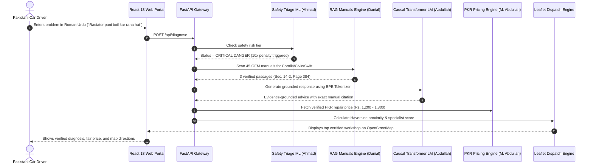

# AutoCare AI — System Architecture Specification (5-Member Engineering Guide)

**Institution:** Department of Data Science, Punjab University College of Information Technology (PUCIT), Lahore  
**Degree Program:** BS Data Science (Session 2023–2027)  
**Supervisor:** Dr. Khurram Shehzad  
**Repository:** [github.com/marketbul/autocare-ai](https://github.com/marketbul/autocare-ai)  
**Deliverables on Desktop:**
- Word Document: `C:\Users\ABDUL\Desktop\AutoCare_AI_System_Architecture.docx`
- Print-Ready PDF: `C:\Users\ABDUL\Desktop\AutoCare_AI_System_Architecture.pdf`

---

## 1. High-Level Architecture Overview (Simple English)

AutoCare AI is built as a **9-layer decentralized Big Data and AI decision-support platform**. Each layer handles a specific task:

```
[Layer 1: Data Sources]         OBD-II CAN-bus (10k msgs/s) + 45 OEM Manuals + PakWheels Q&A
           │
[Layer 2: Ingestion & Parsers]  PDF Chunking Engine + Async Telemetry Streaming Producers
           │
[Layer 3: Message Queue]        Apache Kafka Cluster (KRaft Mode, Topic Partitions)
           │
[Layer 4: Storage Lakehouse]    MinIO S3 Buckets (CAS Deduplication) + Snappy Parquet (75% Savings)
           │
[Layer 5: Fast In-Memory OLAP]  DuckDB Vectorized Engine (<80 ms latency over 500k rows)
           │
[Layer 6: Safety Triage ML]     Cost-Sensitive Classifier (10x Safety Penalty) + Platt Calibration
           │
[Layer 7: AI & Reasoning]       Custom PyTorch Causal Transformer LM (1.32M Params) + 4k BPE RAG
           │
[Layer 8: Backend Server]       FastAPI Async Gateway + Argon2id Auth + Consistent Hash Ring
           │
[Layer 9: User Presentation]    React 18 Web Portal + Localized PKR Pricing + Leaflet Dispatch Map
```

---

## 2. 5-Member Team Allocation & Module Ownership

| Member Name & Roll No. | Assigned Role | Modules Owned | Key Technical Deliverables |
|---|---|---|---|
| **Abdullah**<br/>(`BSDSF23A035`) | **Group Leader & AI Architect** | Module M1 (Gateway), Module M4 (Transformer LM), Module M4B (BPE Tokenizer), Consistent Hash Ring | 1.32M PyTorch Causal Transformer, 4k BPE Vocab, Murmur3 Hash Ring (160 vNodes), FastAPI Gateway |
| **Talha Ali Bhatti**<br/>(`BSDSF23A016`) | **Storage & Ingestion Lead** | Module L3 (Kafka Bus), Module L4 (MinIO S3), Module L4B (CAS Deduplication), Module L4C (Parquet Compaction) | MinIO cluster, 10k msg/s CAN-bus streaming simulator, Snappy Parquet writer, Compaction daemon |
| **Danial Hameed**<br/>(`BSDSF23A014`) | **Data & Multilingual Lead** | Module M1 (Corpus Ingestion), Module M2B (Urdu/Roman Urdu Lexicon), Module M4 (BM25 Search), Module L4D (Bloom Filter) | 111 clean datasets, 45 OEM manuals (326 chunks), Roman Urdu lexicon dictionary, Counting Bloom Filter ($k=4$) |
| **Ahmad Zahid**<br/>(`BSDSF23A033`) | **ML Triage & Safety Lead** | Module M2 (Cost-Sensitive Triage), Module M3 (Platt Calibrator), Module M5 (NLI Quote Verifier), Module M3B (Abstention Filter) | 10x safety penalty triage classifier, Platt ECE calibrator, NLI quote fraud detector, safety pytest suite |
| **Muhammad Abdullah**<br/>(`BSDSF23A032`) | **Frontend & Pricing Lead** | Module L9 (React 18 Portal), Module L5B (DuckDB OLAP), Module M9 (PKR Pricing Engine), Module L9B (Dispatch UI) | React 18 Web Portal, DuckDB in-memory OLAP (<80ms), localized PKR parts estimator, Leaflet dispatch map |

---

## 3. End-to-End Data Flow (Step-by-Step)



---

## 4. Storage Hierarchy (4-Tier Lakehouse Architecture)

1. **Bronze Tier (Raw Data):** MinIO S3 bucket storing raw incoming JSON sensor telemetry logs and original PDF handbooks. Uses SHA-256 Content-Addressable Storage (CAS) deduplication to eliminate redundant copies.
2. **Silver Tier (Clean Lakehouse):** Snappy-compressed Parquet files hierarchically partitioned by `/telemetry/make=X/model=Y/year=Z/region=R/`, saving over 75% storage space.
3. **Gold Tier (Relational DB):** SQLite / PostgreSQL storing application entities (registered users, vehicles, diagnostic histories, specialist mechanics list, and dispatch tickets).
4. **Fast Memory Cache:** 65,536-bit Counting Bloom Filter with $k=4$ hash functions verifying valid diagnostic codes in 1 millisecond.

---

## 5. Fault-to-Specialist Dispatch Formula

When a fault is diagnosed, the engine calculates a composite match score:
$$\text{Score} = (0.40 \times \text{Skill}) + (0.30 \times \text{Distance}) + (0.20 \times \text{Rating}) + (0.10 \times \text{Queue})$$

* **Skill (40%):** Does the workshop specialize in the exact failure subsystem (e.g., Radiator/Cooling vs ABS Brakes)?
* **Distance (30%):** How close is the workshop to the vehicle, calculated using the Haversine GPS formula?
* **Rating (20%):** Past customer repair verification rating (1 to 5 stars).
* **Queue (10%):** Does the workshop have an open service bay right now?

The highest scoring workshop is displayed on an interactive OpenStreetMap view with turn-by-turn routing and fair PKR repair benchmarks.
