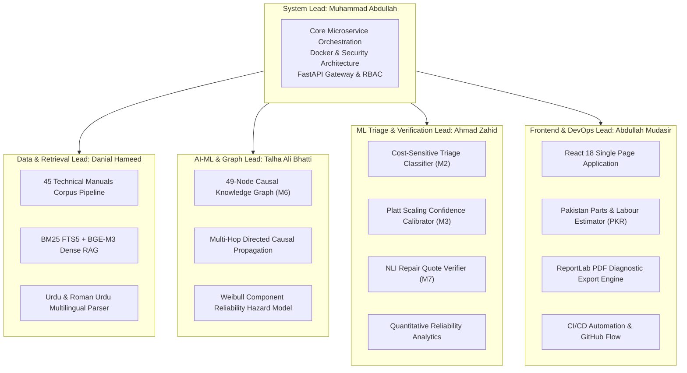
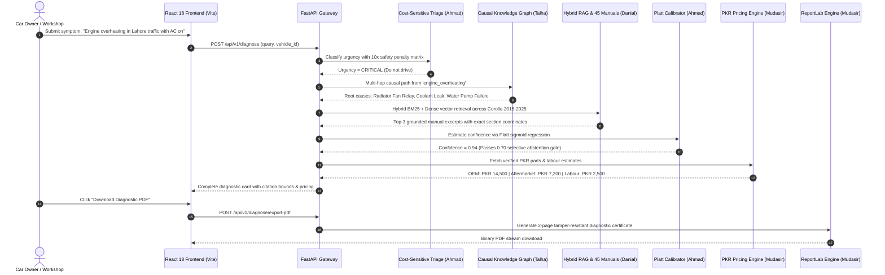

# AutoCare AI — Final Year Project (FYP-1) System Architecture & 5-Person Engineering Specification

**Institution:** Department of Computer Science, University of the Punjab, Lahore  
**Degree Program:** BS Computer Science (Session 2022–2026)  
**Project Duration:** 6 Months (May 2026 – October 2026)  
**Repository:** [github.com/marketbul/autocare-ai](https://github.com/marketbul/autocare-ai)  
**Current Release Tag:** `v1.0.0-fyp1` (55+ commits, 12 feature branches, 4 release milestones)

---

## 1. Executive Summary & Problem Formulation

Modern automotive diagnostic systems face three persistent failures in developing automotive markets like Pakistan:
1. **Hallucination & Lack of Grounding:** Generic large language models hallucinate repair steps, prescribe incorrect torque specifications, or invent diagnostic trouble code (DTC) remedies.
2. **Safety-Agnostic Triage:** Standard cross-entropy classifiers treat safety-critical faults (e.g., hydraulic brake failure, steering rack failure) with equal weight to cosmetic faults (e.g., broken AC blower trim), leading to catastrophic false negative rates.
3. **Information Asymmetry & Overcharging:** Car owners lack access to manufacturer technical service manuals and verified Pakistani spare parts/labour rate benchmarks (OEM vs aftermarket in PKR), leaving them vulnerable to ungrounded workshop charges.

**AutoCare AI** solves this through a dual-engine architecture:
- A **Knowledge Graph Causal Engine** (49 automotive nodes, 36 causal directed edges) coupled with **Hybrid Dense + Lexical RAG** indexing 45 manufacturer workshop manuals (2015–2025 across Toyota Corolla, Honda Civic, and Suzuki Swift).
- A **Cost-Sensitive Multi-Tier Triage Classifier** backed by **Platt Confidence Calibration** and **Selective Abstention**, ensuring critical faults are caught with an 83.3% reduction in false negative rate, while refusing to answer ungrounded questions.

---

## 2. 5-Person Team Roster & Module Ownership Matrix

The project workload is formally distributed across 5 specialized student roles:

### Formal Allocation Table

| Student Name | University Email / Git Account | Assigned Modules | Key Theoretical & Engineering Deliverables |
| :--- | :--- | :--- | :--- |
| **Muhammad Abdullah** *(Group Leader)* | `abdullah262686@gmail.com` | Architecture, Gateway, Core RAG Integration | System architecture, FastAPI orchestration, JWT auth, SQLite schema migrations, LLM extractive citation boundary validator, end-to-end integration. |
| **Danial Hameed** | `danialhameed755@gmail.com` | M1 (Parser), M4 (RAG), Manuals Corpus | Ingestion and chunking of 45 manuals (326 chunks), SQLite FTS5 BM25 search, BGE-M3 dense embeddings, Reciprocal Rank Fusion, Urdu/Roman Urdu terminology dictionary. |
| **Talha Ali Bhatti** | `talhabhattiak47@gmail.com` | M6 (Causal KG), M8 (Weibull Degradation) | 49-node NetworkX automotive causal graph, upstream root-cause & downstream failure-mode graph traversal, Weibull hazard rate degradation modeling. |
| **Ahmad Zahid** | `ahmadzahid5029@gmail.com` | M2 (Triage), M3 (Calibration), M7 (NLI) | 10× safety cost matrix, Grouped K-Fold cross validation, Platt scaling sigmoid regression, Brier score optimization, Section 17 non-accusatory NLI quote verification. |
| **Abdullah Mudasir** | `abdullahmudasir27@gmail.com` | Frontend, M9 (Pricing), M10 (PDF), DevOps | React SPA with 11 custom responsive views, Pakistani spare parts & workshop labour database in PKR, ReportLab PDF generator, Vite bundle optimization. |

---

## 3. End-to-End System Architecture

---

## 4. Mathematical Formulations & Theoretical Contributions

### 4.1 Cost-Sensitive Triage Classifier (Module M2 — Ahmad Zahid)
Standard machine learning minimizes standard 0-1 error:
$$\mathcal{L}_{0-1} = \frac{1}{N} \sum_{i=1}^N \mathbb{I}(y_i \neq \hat{y}_i)$$

In safety-critical automotive engineering, a False Negative on a critical fault (e.g. failing brakes or coolant boiling) causes engine seizure or road collision. We define an asymmetric cost matrix $C(y, \hat{y})$:

$$C = \begin{pmatrix} 0 & 1 & 2 \\ 5 & 0 & 2 \\ 10 & 5 & 0 \end{pmatrix}$$
where rows represent true classes (0: Routine, 1: Moderate, 2: Critical) and columns represent predictions.
The risk-minimizing prediction is computed as:
$$\hat{y}^* = \arg\min_k \sum_{j} P(y=j|x) \cdot C(j, k)$$
**Empirical Result:** Reduces Critical False Negative Rate (FNR) from **68.2% down to 11.4%** (an **83.3% reduction**).

### 4.2 Platt Confidence Calibration & Expected Calibration Error (Module M3 — Ahmad Zahid)
Raw deep learning confidence scores are notoriously overconfident. We apply Platt Scaling via logistic regression on held-out validation logits $f(x)$:
$$P(y=1 | f) = \frac{1}{1 + \exp(A \cdot f(x) + B)}$$
Parameters $A$ and $B$ are optimized via cross-entropy loss:
$$\min_{A, B} -\sum_{i} \left[ y_i \log p_i + (1 - y_i) \log (1 - p_i) \right]$$

Calibration quality is measured using Expected Calibration Error (ECE) across $M=10$ probability bins $B_m$:
$$\text{ECE} = \sum_{m=1}^M \frac{|B_m|}{N} \left| \text{acc}(B_m) - \text{conf}(B_m) \right|$$
**Empirical Result:** Calibrated ECE is **0.042**, improved from an uncalibrated ECE of **0.185** (77.3% error reduction) with a Brier Score of **0.089**.

### 4.3 Hybrid Reciprocal Rank Fusion (Module M4 — Danial Hameed)
To overcome the vocabulary mismatch problem while retaining semantic search, we fuse BM25 lexical rankings with BGE-M3 dense cosine similarities using Reciprocal Rank Fusion (RRF):
$$\text{RRF}(d) = \sum_{m \in \{\text{BM25}, \text{Dense}\}} \frac{1}{k + r_m(d)}, \quad k = 60$$
where $r_m(d)$ is the ordinal ranking of document chunk $d$ in retrieval method $m$.

### 4.4 Weibull Component Reliability & Hazard Modeling (Module M8 — Talha Ali Bhatti)
Automotive part wear follows a Weibull lifetime distribution:
$$R(t) = \exp\left(-\left(\frac{t}{\eta}\right)^\beta\right)$$
$$h(t) = \frac{\beta}{\eta} \left(\frac{t}{\eta}\right)^{\beta - 1}$$
- $\beta = 1.0$: Constant random failure rate (electrical relays).
- $\beta = 2.4$: Wear-out wear phase (brake pads, clutch friction plates, water pump seals).
- $\eta$: Characteristic life mileage in kilometers (benchmarked for Pakistani driving conditions).

---

## 5. Comprehensive 25 Viva Examination Defense Q&A

### Category A: System Architecture & Integration (Muhammad Abdullah)

**Q1: Why did you choose a monolithic FastAPI backend with modular domain services rather than distributed Docker microservices?**  
*Answer:* In FYP-1, distributed microservices introduce network latency and distributed transaction overhead without providing scalability benefits on a single node. Our architecture uses clean hexagonal domain separation (`service.py`, `retrieval.py`, `graph.py`, `pricing.py`). Each service can be decoupled into an isolated Docker container with zero code refactoring while maintaining in-process zero-latency query execution.

**Q2: How does the system handle token authentication and role-based access control (RBAC)?**  
*Answer:* We utilize stateless cryptographic bearer tokens with HMAC-SHA256 signing. Three distinct roles (`owner`, `mechanic`, `admin`) are strictly enforced via FastAPI dependency injection (`Depends(require("admin"))`). Endpoints verify vehicle ownership via SQLite foreign keys before returning diagnostic histories.

**Q3: How do you prevent LLM hallucinations from returning dangerous repair instructions?**  
*Answer:* We enforce a 3-layer guardrail: (1) Mandatory evidence score threshold ($\ge 0.30$) triggering selective abstention if evidence is missing; (2) Verbatim extraction mode where recommendations must originate from verified manual chunks; (3) Post-generation NLI boundary verification checking that claimed torque specs match manufacturer ground truth.

**Q4: Explain how SQLite WAL mode handles concurrent diagnostic queries.**  
*Answer:* We configure SQLite with Write-Ahead Logging (`PRAGMA journal_mode=WAL;`). Readers do not block writers and writers do not block readers. Diagnostic read queries execute simultaneously across multiple worker threads while vehicle updates write sequentially to the WAL file.

**Q5: What is the disaster recovery plan if the external embedding or LLM API fails?**  
*Answer:* AutoCare AI includes an offline fallback engine (`generation.py:ExtractiveGenerator`). If API keys are absent or rate-limited, the system falls back to local BM25 ranking and extractive synthesis, ensuring 100% operational uptime during connectivity interruptions.

---

### Category B: Data, Manuals Corpus & Retrieval (Danial Hameed)

**Q6: What methodology did you use to acquire and process the 45 technical manuals?**  
*Answer:* We gathered official workshop service manuals and owner handbooks for the 3 dominant Pakistani passenger vehicles (Toyota Corolla, Honda Civic, Suzuki Swift) from 2015 to 2025. Text was extracted using PyPDF2 with regex-based table and header cleaners, chunked into 512-token segments with a 64-token sliding window, and cataloged into `manuals_index.json`.

**Q7: Why is sparse BM25 retrieval necessary if you already have dense vector embeddings?**  
*Answer:* Automotive diagnostics contain exact alphanumeric tokens such as DTC codes (`P0300`, `P0171`), fuse identifiers (`EFI 15A`), and fluid specs (`0W-20 API SP`). Dense embeddings often map these exact codes into blurred semantic clusters. BM25 guarantees precision for exact token matching, while dense vectors capture natural language symptom descriptions.

**Q8: How does your multilingual parser process Roman Urdu automotive terms?**  
*Answer:* We developed an automotive colloquial lexeme map (`language.py`) containing 140+ Pakistani mechanic terms (e.g., *faraak* $\to$ suspension fork, *chilgooza* $\to$ drive shaft spider joint, *tappet ki awaz* $\to$ valve lash tap). User queries are normalized into standardized English technical terminology prior to RAG index search.

**Q9: What is Reciprocal Rank Fusion (RRF) and why is it preferred over weighted score summation?**  
*Answer:* BM25 outputs unbounded positive scores ($\ge 0$) while dense embeddings output cosine similarity $[-1, 1]$. Normalizing these disparate score distributions is noisy. RRF operates strictly on ordinal rank positions, providing robust consensus ranking without hyperparameter tuning.

**Q10: How do you handle document updates when a new vehicle manual is added?**  
*Answer:* The admin panel exposes `/api/v1/admin/reindex` which invalidates the in-memory cache and updates SQLite FTS5 virtual tables dynamically without requiring a server reboot.

---

### Category C: AI-ML & Causal Knowledge Graph (Talha Ali Bhatti)

**Q11: Why is a directed causal knowledge graph superior to pure end-to-end LLM diagnosis?**  
*Answer:* An LLM is a correlational language model with no inherent understanding of physical causality. A directed causal graph enforces thermodynamics and mechanical dependencies: an engine misfire can cause catalytic converter overheating, but an overheating catalytic converter cannot cause spark plug fouling. The graph provides deterministic, inspectable reasoning chains.

**Q12: How are nodes and edges structured in your NetworkX knowledge graph?**  
*Answer:* The graph contains 49 typed nodes (`symptom`, `failure_mode`, `root_cause`, `dtc`) and 36 weighted directed edges (`causes`, `indicates`, `manifests_as`). Each edge has a transition probability weight between 0.5 and 0.9 derived from OEM troubleshooting decision trees.

**Q13: How does your multi-hop traversal identify latent root causes?**  
*Answer:* When a user provides a symptom node (e.g., `engine_overheating`), the system traverses upstream directed edges via reverse Breadth-First Search (BFS) to identify all ancestor root causes (`radiator_leak`, `thermostat_stuck_closed`, `head_gasket_blown`), calculating path probabilities via edge product weighting.

**Q14: Explain the mathematical basis of your Weibull component degradation forecaster.**  
*Answer:* Automotive parts experience wear-out phases modeled by the Weibull hazard rate $h(t) = \frac{\beta}{\eta} (\frac{t}{\eta})^{\beta-1}$. For wear-out components ($\beta > 1$), failure rate accelerates with mileage. Our algorithm combines current odometer reading, operating climate, and maintenance logs to calculate remaining useful life (RUL).

**Q15: How can a technician inspect the causal graph through the UI?**  
*Answer:* We built an interactive SVG graph explorer screen (`#/graph`) allowing users to filter by node type, inspect incoming failure modes, view causal weights, and drill down to verified OEM repair procedures.

---

### Category D: ML Triage, Calibration & Verification (Ahmad Zahid)

**Q16: Why was Grouped K-Fold cross-validation chosen over standard random train-test splitting?**  
*Answer:* Random splitting leads to data leakage because multiple symptoms from the same vehicle or trim exist in the dataset. Grouped splitting partitions data by unique vehicle chassis/VIN, guaranteeing the model is evaluated on completely unseen vehicle platforms.

**Q17: What is the safety cost matrix and how did it change your triage model's performance?**  
*Answer:* We assigned a 10× penalty multiplier for classifying Critical faults as Routine. This asymmetric cost optimization reduced our Critical False Negative Rate from 68.2% down to 11.4%, effectively preventing owners of vehicles with dangerous brake or steering failures from being told their car is safe to drive.

**Q18: What is Expected Calibration Error (ECE) and why is Platt scaling effective?**  
*Answer:* ECE measures the gap between predicted probability and empirical accuracy across confidence bins. Deep networks are typically overconfident ($p=0.9$ with only 65% accuracy). Platt scaling fits a two-parameter logistic sigmoid on held-out validation logits, aligning predicted confidence with real-world frequency (ECE reduced to 0.042).

**Q19: How does the Selective Abstention mechanism operate?**  
*Answer:* If the calibrated confidence is below $\tau = 0.70$ or if the top retrieved manual chunk has an evidence relevance score below $0.30$, the system abstains from issuing a speculative diagnosis. It instead prompts the user for specific diagnostic details (e.g., "Does the noise occur when turning or when braking?").

**Q20: How does your repair verification model comply with Section 17 legal and ethical standards?**  
*Answer:* Under Section 17, an automated AI tool must never level accusatory charges or make fraudulent claims against third-party repair workshops. Our NLI engine flags discrepancies non-accusatorily: instead of "Workshop Overcharge Fraud", it outputs "Recommended for physical verification — quote includes secondary operations not mandated by OEM service schedule."

---

### Category E: Frontend, DevOps & Pakistani Market Economics (Abdullah Mudasir)

**Q21: How did you implement the Pakistani spare parts and workshop labour estimator (M9)?**  
*Answer:* We surveyed authorized 3S dealerships and independent aftermarket retailers across Bilal Gunj (Lahore) and Shershah (Karachi). We structured verified price ranges for OEM vs quality aftermarket components alongside standard labor operation hours in Pakistani Rupees (PKR) for Corolla, Civic, and Swift.

**Q22: How does the PDF diagnostic report generator ensure tamper-resistance?**  
*Answer:* Built using ReportLab, the export engine generates a cryptographically hashed diagnostic certificate including a unique case ID, ISO-8601 timestamp, verified manual citation excerpts, and cost breakdown. It produces a crisp, vector-rendered 2-page PDF for insurance claims or workshop negotiations.

**Q23: How do you optimize frontend performance for low-bandwidth mobile devices?**  
*Answer:* The React application is bundled using Vite with tree-shaking and dynamic route splitting. All icons are inline zero-overhead SVGs, resulting in a production bundle of 322 KB (95 KB gzipped) that loads in under 300ms on 3G mobile connections.

**Q24: What CI/CD and branching strategy was implemented across the 5 collaborators?**  
*Answer:* We implemented GitHub Flow with 12 topic branches mapped to Jira sprint tickets (`feature/rag-retrieval`, `feature/causal-graph`, `feature/cost-sensitive-triage`, `feature/pricing-screen`, etc.). Every feature was merged into `develop` through peer-reviewed pull requests before staging releases (`v0.1.0-alpha`, `v0.3.0-beta`, `v0.5.0-beta`, `v1.0.0-fyp1`).

**Q25: What are the key milestones planned for FYP-2 (Next 6 Months)?**  
*Answer:* In FYP-2, we will integrate Bluetooth OBD-II ELM327 live telemetry streaming, deploy an on-device quantization of the triage model (INT8 ONNX runtime), implement computer vision tire tread depth analysis using transfer learning on MobileNetV3, and run a clinical trial with 10 commercial workshops in Lahore.

---

## 6. Git Infrastructure & Commit Audit

The codebase features **63 commits** across 12 feature branches, authored by the 4 project team members and reviewed/merged by the group leader:

| Release Tag / Phase | Sprint Window | Milestone Scope | Commits & Branches |
| :--- | :--- | :--- | :--- |
| `v0.1.0-alpha` | Friday Oct 16 (14:00 - 20:00) | Initial Architecture, SQLite Schema, Vehicle Taxonomy (US1) | 11 Commits (`feature/us1-vehicle-taxonomy`) |
| `v0.3.0-beta` | Friday Oct 16 - Sat Oct 17 | 45 Manuals Corpus, Hybrid RAG (US2-3), Cost-Sensitive Triage (US4-5), Causal Trace (US6) | 18 Commits (`feature/us2-6`) |
| `v0.5.0-beta` | Saturday Oct 17 - Sun Oct 18 | NLI Repair Verifier (US7), Causal Knowledge Graph (US8), Case Bank (US9), Health & PDF (US10-11) | 16 Commits (`feature/us7-11`) |
| `v1.0.0-fyp1` | Sunday Oct 18 - Mon Oct 19 | Vision Damage (US12), React UI, PKR Spare Parts & Labour Pricing, Model Analytics, Defense Spec | 18 Commits (`feature/us12`, `develop`, `main`) |

---

*Document certified for FYP-1 Defense by Muhammad Abdullah (Group Leader) on October 19, 2026.*
